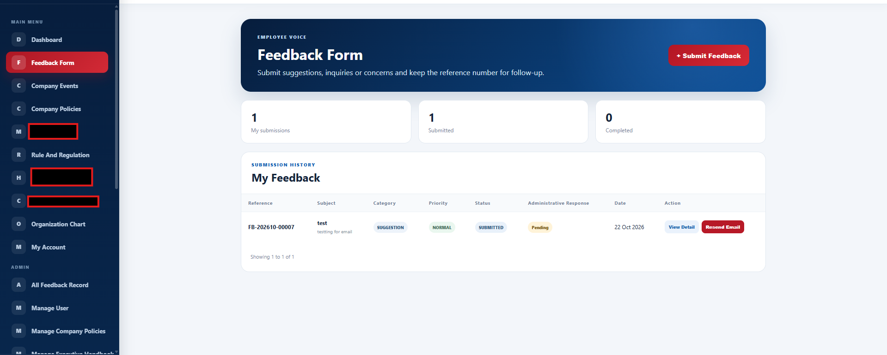
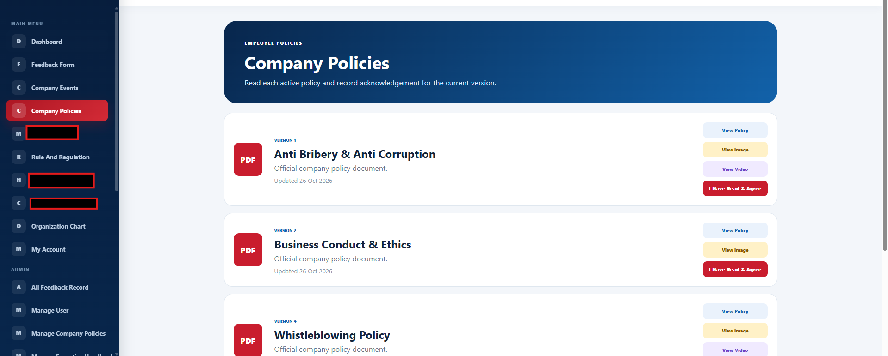

# EMPLOYEE DIGITAL PLATFORM

### Internal Employee Experience & Business Workflow System

 

&nbsp;

&nbsp;

  

**A centralized employee-facing platform designed to digitalize internal communication,  
feedback processes, policy workflows, and administrative operations.**

 

`PHP` &nbsp;•&nbsp; `MySQL` &nbsp;•&nbsp; `JavaScript` &nbsp;•&nbsp; `HTML5` &nbsp;•&nbsp; `CSS3`

  

> 🔒 **Public Portfolio Case Study**  
> Production source code and sensitive organizational information are intentionally excluded.

 

---

# Project Overview

The **Employee Digital Platform** is an internal web-based business application developed to provide employees and authorized administrators with a structured digital environment for employee-related workflows.

The platform centralizes multiple operational processes into a single system, reducing reliance on fragmented or manual workflows while improving accessibility, administration, traceability, and user experience.

 

### Project Scope

| | |
|---|---|
| **Application Type** | Internal Web Application |
| **User Reach** | Up to 300 users |
| **Primary Users** | Employees & Authorized Administrators |
| **Development Scope** | End-to-End Full-Stack Development |
| **Platform** | Responsive Web Application |
| **Backend** | PHP |
| **Database** | MySQL |
| **Front-End** | JavaScript, HTML5, CSS3 |

 

---

# Business Challenge

Employee-related processes can become fragmented when feedback, internal policies, documents, acknowledgements, and administrative workflows are managed through separate or manual methods.

The project was developed to provide a structured platform capable of:

- Centralizing employee-facing digital processes
- Improving accessibility to internal information
- Creating structured administrative workflows
- Supporting controlled access to system functions
- Maintaining organized digital records
- Improving traceability of employee-related workflows
- Providing a consistent responsive user experience

 

---

# The Solution

I developed a centralized **PHP and MySQL business application** combining employee-facing functionality with controlled administrative capabilities.

The solution was designed around three core principles:

<table>
<tr>

<td width="33%" valign="top">

### Accessible

A centralized responsive interface provides employees with access to relevant functions and information.

</td>

<td width="33%" valign="top">

### Structured

Manual and fragmented processes are converted into organized digital workflows supported by database-driven records.

</td>

<td width="33%" valign="top">

### Controlled

Application functions and information are managed according to authorized user access and administrative requirements.

</td>

</tr>

</table>

 

---

# Key Capabilities

<table>

<tr>

<td width="50%" valign="top">

### Employee Feedback Management

Structured workflow supporting employee feedback submission and administrative follow-up.

**Capabilities**

✓ Digital feedback submissions  
✓ Submission history  
✓ Category & priority management  
✓ Status tracking  
✓ Administrative response workflow  
✓ Follow-up actions

</td>

<td width="50%" valign="top">

### Policy & Acknowledgement

Centralized distribution of internal policies with structured employee acknowledgement.

**Capabilities**

✓ Policy distribution  
✓ Version management  
✓ Document access  
✓ Image & video content support  
✓ Employee acknowledgement  
✓ Structured policy records

</td>

</tr>

<tr>

<td width="50%" valign="top">

### Role-Based Functionality

Application functionality can be presented according to authorized user access.

**Capabilities**

✓ Controlled application access  
✓ Role-aware functionality  
✓ Restricted administrative features  
✓ Structured user management

</td>

<td width="50%" valign="top">

### Administrative Workflows

Administrative functions support structured management of employee-facing information and application workflows.

**Capabilities**

✓ Record management  
✓ Workflow administration  
✓ User-related functions  
✓ Content management  
✓ Operational visibility

</td>

</tr>

</table>

 

---

# System Showcase

Only selected employee-facing workflows that are suitable for a public professional portfolio are presented below.

Administrative interfaces containing employee information or other sensitive operational records are intentionally excluded.

 

## 01 · Employee Feedback Management

Employee-facing workflow designed for structured feedback submission, submission tracking, administrative follow-up, and historical visibility.

 

  

 

### Capabilities Demonstrated

`DIGITAL SUBMISSION`
&nbsp;
`STATUS TRACKING`
&nbsp;
`PRIORITY MANAGEMENT`

  

`ADMINISTRATIVE RESPONSE`
&nbsp;
`SUBMISSION HISTORY`
&nbsp;
`FOLLOW-UP ACTIONS`

 

The interface provides a centralized employee view of feedback records including submission reference, category, priority, current status, administrative response status, date, and available actions.

 

---

## 02 · Policy & Acknowledgement Management

Structured employee policy distribution supporting version-controlled content, multiple communication formats, and acknowledgement recording.

 

  

 

### Capabilities Demonstrated

`POLICY VERSIONING`
&nbsp;
`DOCUMENT ACCESS`
&nbsp;
`IMAGE CONTENT`

  

`VIDEO CONTENT`
&nbsp;
`EMPLOYEE ACKNOWLEDGEMENT`
&nbsp;
`STRUCTURED RECORDS`

 

The workflow allows active policies to be presented in structured versions while employees can access available document, image, or video content before recording acknowledgement of the applicable policy version.

 

---

## Why Only Selected Screens Are Shown

This portfolio intentionally demonstrates **selected application capabilities rather than the complete production environment**.

Additional administrative modules exist, but interfaces containing employee records, access-management information, internal operational records, or other sensitive information are not included in this public repository.

This approach allows the project to demonstrate real application development work without unnecessarily exposing production information.

 

---

# My Contribution

This project involved the **complete application lifecycle**, rather than a single development task.

### `01` Requirements Analysis

Understanding operational requirements and existing business processes.

↓

### `02` Process & Solution Design

Translating operational requirements into structured digital workflows.

↓

### `03` Database Design

Designing application data structures and relationships using MySQL.

↓

### `04` Full-Stack Development

Developing server-side functionality, business logic, database integration, and responsive user interfaces.

↓

### `05` Testing & Deployment

Testing application workflows and deploying the solution into the operational environment.

↓

### `06` User Adoption & Support

Supporting implementation, application usage, and user requirements.

↓

### `07` Continuous Improvement

Maintaining and improving application functionality based on evolving operational requirements.

 

---

# Technology Stack

 

| Layer | Technology / Approach |
|---|---|
| **Backend Development** | PHP |
| **Database** | MySQL |
| **Client-Side Logic** | JavaScript |
| **Interface** | HTML5 / CSS3 |
| **Application Model** | Database-Driven Web Application |
| **Design Approach** | Responsive Web Interface |
| **Deployment Context** | Internal Business Environment |

 

---

# Security & Privacy Considerations

Because the platform supports employee-facing processes, **privacy, access control, and responsible information handling** are important application considerations.

The design includes considerations around:

- Authentication and controlled system access
- Role-based application functionality
- Protection of employee-related information
- Restricted administrative capabilities
- Controlled access to sensitive workflows
- Secure handling of internal records
- Separation of employee and administrative functions
- Responsible disclosure of production information

> Detailed production security architecture is intentionally not disclosed in this public portfolio.

 

---

# Project Outcome

The project demonstrates the ability to take real operational requirements and deliver a working business application across the complete development lifecycle.

### Key Outcomes

✓ Centralized employee-facing digital platform  
✓ Structured digital business workflows  
✓ Database-driven record management  
✓ Policy versioning and acknowledgement processes  
✓ Employee feedback and follow-up workflow  
✓ Responsive employee interface  
✓ Controlled administrative functionality  
✓ Support for up to **300 users**  
✓ Ongoing operational support and continuous improvement

 

---

# What This Project Demonstrates

<table>

<tr>

<td width="50%" valign="top">

### Technical Capability

- Full-Stack Web Development
- PHP Application Development
- MySQL Database Design
- JavaScript Development
- Responsive UI Development
- Database-Driven Workflows
- Application Testing
- Application Deployment

</td>

<td width="50%" valign="top">

### Professional Capability

- Requirements Analysis
- Business Process Digitalization
- Solution Design
- User-Focused Development
- Operational Implementation
- User Support
- Privacy-Conscious Development
- Continuous Improvement

</td>

</tr>

</table>

 

---

# Confidentiality & Portfolio Disclosure

This repository is a **professional portfolio case study only**.

The production application is an internal proprietary business system.

For security, privacy, and confidentiality reasons, this public repository intentionally does **not** contain:

- Production source code
- Database schemas or database dumps
- Authentication credentials
- Employee personal information
- Confidential feedback submissions
- Administrative employee records
- Production URLs or domains
- Internal server information
- Security configurations
- Organization-specific infrastructure details

Screenshots are limited to selected interfaces considered appropriate for public portfolio presentation.

 

---

## Employee Digital Platform

### Full-Stack Business Application Development

`BUSINESS SYSTEMS`
&nbsp; • &nbsp;
`EMPLOYEE EXPERIENCE`
&nbsp; • &nbsp;
`PROCESS DIGITALIZATION`

  

**Designed · Developed · Deployed · Supported**

  

[← Back to Professional Portfolio](https://github.com/iwan2408)

